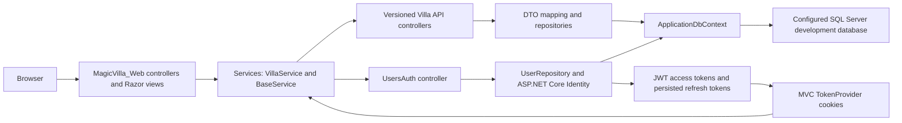
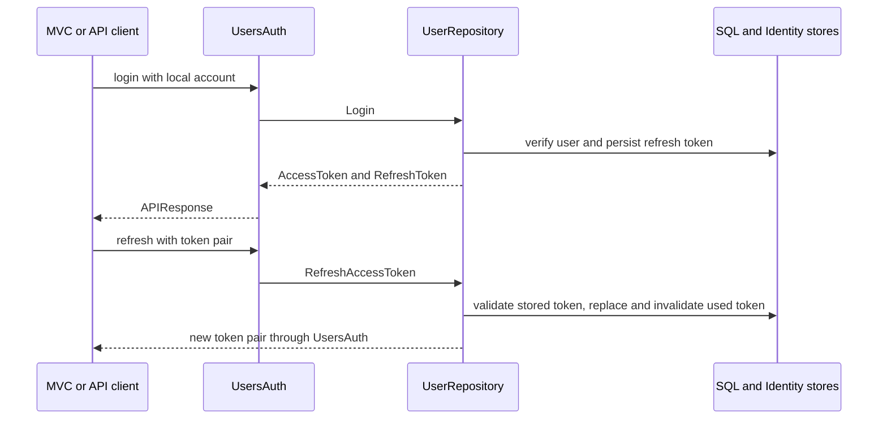

# Architecture: versioned API and MVC client

[Walkthrough](WALKTHROUGH.md) · [Repository overview](../README.md)

This is a map of implementation paths, not a verified deployment.

## Choices and tradeoffs visible in the code

| Choice | Code path and effect |
|---|---|
| API version in the URL | [V1 controller](../MagicVilla_VillaAPI/Controllers/V1/VillaAPIController.cs), [V2 controller](../MagicVilla_VillaAPI/Controllers/V2/VillaAPIController.cs) and [versioning registration](../MagicVilla_VillaAPI/Program.cs) select controllers through `/api/v{version}/VillaAPI`. Separate controllers demonstrate version routing; their presence does not imply every operation differs between versions. |
| MVC service boundary | [VillaService](../MagicVilla_Web/Services/VillaService.cs) delegates requests to [BaseService](../MagicVilla_Web/Services/BaseService.cs). `ServiceUrls:VillaAPI` and the [current version constant](../MagicVilla_Utility/SD.cs) select the API endpoint rather than direct EF calls from the MVC client. |
| DTOs around entities | [VillaDTO](../MagicVilla_VillaAPI/Models/Dto/VillaDTO.cs) defines the response shape; controllers map repository entities to DTOs. Model/validation rules are in the operation's specific DTO. |
| Repository query pipeline | [Repository.GetAllAsync](../MagicVilla_VillaAPI/Repository/Repository.cs) applies occupancy filtering, then Skip/Take when pageSize is positive. The controller applies text search afterwards, so a page may contain fewer search matches than the requested page size. |
| Token lifecycle | [UsersController](../MagicVilla_VillaAPI/Controllers/UsersController.cs) exposes login/refresh/revoke, while [UserRepository](../MagicVilla_VillaAPI/Repository/UserRepository.cs) stores refresh-token state and replaces a used refresh token. Both the API host and token persistence depend on the configured SQL target. |
| Customer-only registration | Register ignores elevated requested roles and assigns `customer`; [regressions](../tests/Authorization.Tests/RegistrationSecurityTests.cs) cover the role assignment and failure paths. Villa create/delete/update actions declare `admin` where shown in the controllers; this document is not an exhaustive authorization audit. |

The collection query has no explicit stable ordering before pagination. The X-Pagination header reports requested page parameters, not a total-result count; pageSize values above 100 are clamped in the repository. The manual walkthrough avoids promising a fixed order or exact page membership.

## Token request sequence

The MVC [TokenProvider](../MagicVilla_Web/Services/TokenProvider.cs) writes access/refresh tokens to browser cookies. Token cookies now use HttpOnly, Secure and SameSite=Lax. Refresh/revoke validate the signed pair and use a SQL transaction/locking path; deployed browser behavior and SQL concurrency remain unverified.

## Runtime boundaries

[Program](../MagicVilla_VillaAPI/Program.cs) applies pending migrations at API startup. A build/test command does not run that host. Tests cover registration roles, JWT pair validation, mutation policies, patch/storage fields, API failures and in-process MVC antiforgery; successful CI does not establish a live refresh/revoke integration, complete CRUD coverage or production readiness. Configuration guidance is in [SECURITY-SETUP.md](../SECURITY-SETUP.md).

See [Security boundaries](SECURITY-BOUNDARIES.md) for token expiry/rotation, uploads and verification limits.
